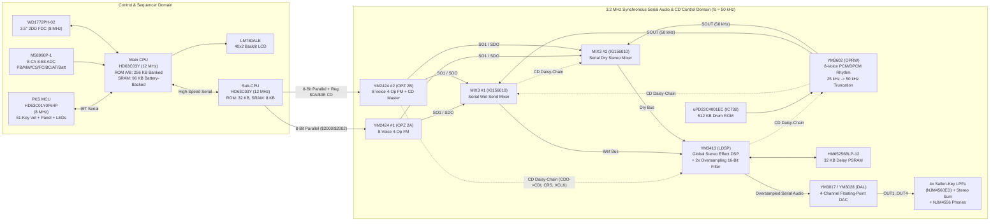

# Victory VF50 Digital Synthesizer — Master Hardware & DSP Architecture Specification

**Document ID:** `VF50_MASTER_SPEC.md`  
**Target System:** Victory VF50 Music Workstation (`1989`, Firmware `'89/01/28 06:50Ver. M0.00'`)  
**Sources Verified:**
- Official Service Manuals & Schematics (`VF50_SM1_C.pdf`, `VF50_SM2_C.pdf`, `VF50_PL_C.pdf`, `VF50_TEST_C.pdf`, `VF50_CD.pdf`)
- Authorized Operating Manual (`VF50 Operating Reference Manual`, 171 pages)
- Main CPU, Sub-CPU, and Drum Mask ROMs (`IC712 XF805 C0.BIN`, `IC723 XF810 C0.BIN`, `IC731 XF804 B0.BIN`, `XF653A0-101 IC738.BIN`)

---

## 1. System Topology, Clocks & Multi-CPU Architecture

The Victory VF50 mainboard (`DM` board `VG272800`) is a **three-microprocessor, multi-chip serial digital audio workstation** combining a 16-voice 4-operator FM synthesizer (dual `YM2424 OPZ II`), an 8-voice PCM/DPCM rhythm machine (`YM3602 OPRW`), a global stereo DSP & 16-bit oversampling digital filter (`YM3413 LDSP`), an 8-track / 16,000-note sequencer, a 3.5" 2DD floppy disk subsystem, and a 61-key velocity + channel-aftertouch keyboard.

### 1.1 Master Oscillators & Sample Rates

| Clock Source | Part Number | Frequency | Consumers & Derived Rates |
|---|---|---|---|
| **Master Audio Crystal** | `VD032300` (`KD0855F`) | **3.200000 MHz** | `YM2424` ×2, `YM3602`, `YM3413`, `MIX3` ×2, `DAL` |
| **FM / Bus Word Clock (`SYW`)** | `3.2 MHz / 64` | **50,000.0 Hz** (`20.0 us`) | Native sample rate of `YM2424` FM, `MIX3` serial buses, and `YM3413` DSP core |
| **Drum Native Readout Rate** | `3.2 MHz / 128` | **25,000.0 Hz** (`40.0 us`) | `YM3602` ROM sample clock; upsampled 2× to `50,000 Hz` via zero-order hold (truncation) |
| **Oversampled Filter / DAC Rate** | `2 × 50,000 Hz` | **100,000.0 Hz** | `YM3413` 16-bit 2× oversampling digital output filter feeding `DAL` |
| **CPU Ceramic Resonators** | `VF579400` (`CST12.0MT`) | **12.000 MHz** | Main CPU (`HD63C03Y`, `E = 3.0 MHz`) & Sub-CPU (`HD63C03Y`, `E = 3.0 MHz`) |
| **Scanner & FDC Resonators** | `VB657100` (`CST8.00M`) | **8.000 MHz** | PKS Scanner (`HD63C01Y0F64P`, `E = 2.0 MHz`) & `WD1772PH-02` FDC |

### 1.2 Complete Mainboard IC Inventory

| Function | Schematic / Hardware P/N | Manufacturer Device | Architecture Details |
|---|---|---|---|
| **Main CPU** | `XD681001` | Hitachi `HD63C03Y` | UI, MIDI, Sequencer, Rhythm Engine, SysEx, FDC, Card, Banked Memory |
| **Main Firmware ROM A** | `IC712` / `XF805C00` | `128 KB` Mask/EPROM | Contiguous 8-bit; Banks `0..7` (`16 KB` each); Voice/Perf/Microtuning ROM |
| **Main Firmware ROM B** | `IC723` / `XF810C00` | `128 KB` Mask/EPROM | Contiguous 8-bit; Banks `8..15` (`16 KB` each); Sequencer & Rhythm ROM |
| **Main Battery SRAM** | `XF914A00` (×3) | NEC `uPD43257AC-12LL` | `3 × 32 KB = 96 KB` (`CR2032` backed): `32 KB` System/Voice/Perf/Rhythm + `64 KB` Seq |
| **Sub-CPU** | `XD681001` | Hitachi `HD63C03Y` | Real-time voice allocation, LFO1/LFO2, PEG, Pitch/Microtuning, OPZ/OPRW/LDSP driver |
| **Sub-CPU Firmware ROM** | `IC731` / `XF804B00` | `32 KB` Mask/EPROM | Contiguous 8-bit mapped linearly at `$8000–$FFFF`; contains 32 LDSP presets & OPRW tables |
| **Sub-CPU Working SRAM** | `XC890001` | Toshiba `TC5564APL-15` | `8 KB` (`$6000–$7FFF`) voice state, envelope/LFO accumulators, CD transmit queue |
| **PKS Scanner MCU** | `XF148A00` | Hitachi `HD63C01Y0F64P` | Scans 61-key dual-contact velocity matrix, 55 panel switches, and 16 single/dual-color LEDs |
| **FM Tone Generators** | `IC734, IC735` / `XF171A00` | Hardware `YM2424` (`OPZ II`) | Dual 8-voice, 4-operator, 8-waveform FM synthesizers (`16` total voices) |
| **Rhythm Tone Generator** | `IC737` / `XA802001` | Hardware `YM3602` (`OPRW`) | 8-voice PCM/DPCM rhythm generator with internal multi-stage EGs |
| **Drum Waveform ROM** | `IC738` / `XF653A00` | NEC `uPD23C4001EC-101` | `512 KB` (`4 Mbit`) 8-bit ROM holding Wave Lookup Table + 61 hybrid PCM/DPCM drums |
| **Serial Digital Mixers** | `IG156010` (×2) | Hardware `MIX3` (`MIX A`, `MIX B`) | 4-input serial digital summing mixers for Wet Effect Send (`MIX A`) & Dry Stereo (`MIX B`) |
| **Global Stereo DSP** | `IC739` / `XE449A00` | Hardware `YM3413` (`LDSP`) | Global stereo effect processor + 16-bit 2× oversampling digital filter |
| **DSP Delay RAM** | `IC740` / `XB243001` | Hitachi `HM65256BLP-12` | `32 KB` (`16K × 16` equiv.) PSRAM external audio delay line for `YM3413` |
| **4-Channel DAC (`DAL`)** | `IC741` / `XA800001` | Hardware `YM3017` / `YM3028` (`DAL`) | 4-channel floating-point serial DAC (`OUT1..OUT4`). *Note: Architectural documentation refers to the 4-channel oversampling DAL block as `YM3028 (DAL)`, while schematic `VF50_CD.pdf` & Parts List `VF50_PL_C.pdf` specify `IC741 = XA800001 YM3017 DAL`.* |
| **Analog ADC** | `IG106100` | Mitsubishi `M58990P-1` | 8-channel, 8-bit successive-approximation ADC (`IN0..IN7`) |
| **Floppy Controller** | `XB623001` | Western Digital `WD1772PH-02` | 3.5" 2DD (`720 KB` MFM) floppy disk controller/formatter |
| **LCD Display** | `VF575200` | Sharp/Optrex `LM780ALE` | 40-character × 2-line LED-backlit dot-matrix character LCD (`HD44780` protocol) |

### 1.3 Main CPU & Sub-CPU Memory Maps

#### Main CPU (`HD63C03Y`) Address Space
- `$0000–$001F`: Internal `HD63C03Y` I/O registers (`P50..P53` selects ROM bank `0..15`: `0..7` in `IC712`, `8..15` in `IC723`).
- `$0040–$013F`: Internal `256 B` zero-page CPU RAM (`$95/$97` block copy pointers).
- `$0800–$1FFF`: Memory-mapped peripheral I/O (`LCD`, `WD1772` FDC, `M58990P-1` ADC, Memory Card detect/bank latch, Rhythm SRAM bank latch `$0BC0`).
- `$2000–$7FFF`: Battery-backed System SRAM (`24 KB` fixed window + banked `64 KB` Sequencer/Rhythm RAM):
  - `$2601–$2618`: Active 12-note Microtuning octave buffer (`24 B`)
  - `$2619–$2718`: Active 128-key Microtuning full-keyboard buffer (`256 B`)
  - `$2816–$2888`: Active Performance Edit Buffer (`PCED + PCED2`, `115 B`)
  - `$289B–$291F`: Unpacked Voice Edit Buffer (`VCED + ACED + ACED2 + ACED3`, `133 B`)
  - `$3500–$5ADF`: `100` Internal Performances (`100 × 97 = 9,700 B`)
  - `$5AE4–$7FFF`: `100` Internal Single Voices (`100 × 95 = 9,500 B`)
  - `$49CA–$4AC9`: Expanded 128-key runtime Microtuning table (`128 × 2 = 256 B`; `C3` = `$4A42`)
- `$8000–$BFFF`: **Switchable `16 KB` Firmware ROM Bank (`0..15`)**:
  - `Bank 5` (`IC712 + 0x14000`): Microtunings (`$84FD`, `0x144FD`) & `100` Factory Single Voices (`$9A00`, `0x15A00..0x17F1B`)
  - `Bank 6` (`IC712 + 0x18000`): `100` Factory Performances (`$9A00`, `0x19A00..0x1BFE3`)
  - `Bank 12` (`IC723 + 0x10000`): Rhythm LCD UI, 61 Drum Names (`$9AB5`, `0x11AB5`), `100` Factory Rhythm Patterns (`$9F88..$B105`, `0x11F88..0x13105`), 3 Preset Key Maps (`$B1E2`, `0x131E2`), Rhythm Default Init (`$B680`, `0x13680`)
- `$C000–$FFFF`: **Fixed `16 KB` Kernel Bank (`Bank 7`)** (identical in both `IC712` and `IC723`, Reset Vector `$C000`, Cross-bank trampoline `$EFE1`).

#### Sub-CPU (`HD63C03Y`) Address Space
- `$0000–$001F`: Internal I/O & SCI serial link to Main CPU.
- `$2000–$2001`: `YM2424 #2` (`OPZ 2B`, voices `8..15` + Serial `CD` Master via Reg `$0A` / `$0E`).
- `$2002–$2003`: `YM2424 #1` (`OPZ 2A`, voices `0..7`).
- `$6000–$7FFF`: `8 KB` Sub-CPU SRAM (`TC5564APL-15`).
- `$8000–$FFFF`: `32 KB` Sub-CPU Firmware ROM (`IC731`, Reset Vector `$8000`):
  - `$B2C6 / $B306 / $B346` (`IC731 + 0x32C6..0x3383`): 61-entry `OPRW` Drum Wave ID, Pitch, and Pan tables.
  - `$CAA0–$CD1F` (`IC731 + 0x4AA0..0x4D1F`): `32 × 20-byte` `YM3413 (LDSP)` Effect Preset Register Blocks.

---

## 2. Dual YM2424 (OPZ II) 4-Operator FM Synthesis Engine

The VF50 employs **two `YM2424` (`OPZ II`, `XF171A00`) ICs** running synchronously off the `3.200 MHz` crystal (`fs = 50,000 Hz`, 64 clock cycles per 8-voice × 4-operator sample frame), providing **16-voice polyphonic, 8-part multi-timbral 4-operator phase-modulation synthesis**.

### 2.1 The 8 FM Algorithms (`ALG 0..7` -> LCD `1..8`)

Operator indices follow Hardware's physical synthesis convention (`OP1..OP4`), where **OP4 is always the sole self-feedback operator (`FB 0..7`)**. Note that in ROM/SysEx `VMEM` and `VCED`, operators are stored in reverse-slot order **`[OP4, OP2, OP3, OP1]`**.

| Algorithm | Signal Topology (`->` Phase Modulation, `+` Carrier Sum) | Carriers | Modulators |
|---|---|---|---|
| **Alg 1** (`0`) | `[OP4(FB) -> OP3 -> OP2 -> OP1]` | `OP1` | `OP2, OP3, OP4` |
| **Alg 2** (`1`) | `[(OP4(FB) + OP3) -> OP2 -> OP1]` | `OP1` | `OP2, OP3, OP4` |
| **Alg 3** (`2`) | `[(OP4(FB) + (OP3 -> OP2)) -> OP1]` | `OP1` | `OP2, OP3, OP4` |
| **Alg 4** (`3`) | `[((OP4(FB) -> OP3) + OP2) -> OP1]` | `OP1` | `OP2, OP3, OP4` |
| **Alg 5** (`4`) | `[OP2 -> OP1] + [OP4(FB) -> OP3]` | `OP1, OP3` | `OP2, OP4` |
| **Alg 6** (`5`) | `[OP4(FB) -> OP1] + [OP4(FB) -> OP2] + [OP4(FB) -> OP3]` | `OP1, OP2, OP3` | `OP4` |
| **Alg 7** (`6`) | `OP1 + OP2 + [OP4(FB) -> OP3]` | `OP1, OP2, OP3` | `OP4` |
| **Alg 8** (`7`) | `OP1 + OP2 + OP3 + OP4(FB)` (pure 4-carrier additive) | `OP1, OP2, OP3, OP4` | *(OP4 self-FB)* |

**Feedback Scaling (`FB 0..7`):**
- `FB = 0`: `0` (disabled).
- `FB = 1..7`: Two-sample averaged phase feedback `(y[n-1] + y[n-2]) >> (9 - FB)` in 10-bit phase units (`pi / 2^(8 - FB)` radians peak).

### 2.2 The 8 Operator Waveforms (`W1..W8`)

Each operator has a 10-bit phase lookup (`theta = 2 * pi * p / 1024`, `p in [0, 1023]`) feeding the hardware log-sine (`256-entry quarter-wave`) and `2^-x` exponential tables across 8 selectable waveforms (`OSW 0..7`):

| Wave | Name | Exact Piecewise Definition (`theta in [0, 2*pi)`) | Harmonic Character |
|---|---|---|---|
| **W1** (`0`) | Full Sine | `sin(theta)` | Fundamental only |
| **W2** (`1`) | Squared Sine (`sin^2` bipolar) | `+sin^2(theta)` for `theta in [0, pi)`; `-sin^2(theta)` for `theta in [pi, 2*pi)` | Warm odd harmonics (1st, 3rd, 5th; steeper zero-crossing) |
| **W3** (`2`) | Half-Wave Sine | `sin(theta)` for `theta in [0, pi)`; `0` for `theta in [pi, 2*pi)` | Fundamental + even harmonics |
| **W4** (`3`) | Half-Wave Squared Sine | `+sin^2(theta)` for `theta in [0, pi)`; `0` for `theta in [pi, 2*pi)` | Narrow smooth pulse |
| **W5** (`4`) | Alternating Double-Freq Sine | `sin(2 * theta)` for `theta in [0, pi)`; `0` for `theta in [pi, 2*pi)` | Resonant 2nd-harmonic sync |
| **W6** (`5`) | Alternating Double-Freq `sin^2` | `sgn(sin(2 * theta)) * sin^2(2 * theta)` for `theta in [0, pi)`; `0` for `[pi, 2*pi)` | Formant/clavinet sync |
| **W7** (`6`) | Rectified Double-Freq Sine | `abs(sin(2 * theta))` for `theta in [0, pi)`; `0` for `theta in [pi, 2*pi)` | Bright reed / nasal buzz |
| **W8** (`7`) | Rectified Double-Freq `sin^2` | `sin^2(2 * theta)` for `theta in [0, pi)`; `0` for `theta in [pi, 2*pi)` | Sharpest harmonic impulse |

### 2.3 Ratio & Fixed Frequency Modes (Down to Stationary `0.00 Hz` DC)

Each operator supports **Ratio Mode (`FIX = 0`)** and **Fixed Frequency Mode (`FIX = 1`)**, controlled by `CRS` (`0..63`), `FINE` (`0..15`), `DET` (`-3..+3`), `FIXRG` (`0..7`), and the OPZ II extended **`FIXRM` (`Shift = HI / LO`)** bit (`ACED2` / `VMEM` bit 6 of byte `73+2*op`).

#### A. Ratio Mode (`FIX = 0`)
The 64 `CRS` families intertwine integer harmonics (`1, 2, 3..`), `sqrt(2)` (`1.41, 2.82..`), `pi/2` (`1.57, 3.14..`), and `sqrt(3)` (`1.73, 3.46..`) families (`IC712 + 0x0ECEC`):
- `CRS = 0..3`: `0.50, 0.71, 0.78, 0.87` (with 16 fine steps each; e.g. `CRS=0, FINE=0..15` -> `0.50..0.96`).
- `CRS = 4..63`: `1.00` up to `25.95` (where `FINE = 0..15` interpolates linearly across the family step).

#### B. Fixed Frequency Mode (`FIX = 1`) — `HI` (`8 Hz – 32,640 Hz`) & `LO` (`0.00 Hz – 100 Hz`)
Verified directly from the VF50 firmware (`IC712 Bank 3 $AD30–$AE4C`, `0x0ED30–0x0EE4C`):
Let the 8-bit frequency mantissa be:
$$M = \left\lfloor \frac{\text{CRS}}{4} \right\rfloor \times 16 + \text{FINE} \quad \in [0, 255]$$

1. **`FIXRM = 0` (`Shift = HI`, LCD ranges `'255', '510', ' 1K', ' 2K', ' 4K', ' 8K', '16K', '32K'`)**:
   - Note: hardware clamps `M == 0` in `Range = 0` up to `M = 8` (`8 Hz` minimum in TX81Z-compatible `HI` mode):
   $$f_{\text{HI}}(R, M) = \max(M, \, 8 \cdot \delta_{R,0}) \times 2^{R}\text{ Hz} \quad \implies \quad 8\text{ Hz} \dots 32,640\text{ Hz}$$

2. **`FIXRM = 1` (`Shift = LO`, OPZ II Extended Sub-Audio Mode, LCD ranges `'  1', '  2', '  4', '  7', ' 14', ' 25', ' 50', '100'`)**:
   - **No non-zero floor is applied when `M = 0`!** Setting `CRS = 0, FINE = 0` (`M = 0`) halts the phase increment completely (`f = 0.00 Hz`), turning the operator into a **stationary waveshaper / DC phase-offset modulator** (as used in classic VF50/DX11 timbres):
   $$f_{\text{LO}}(R, M) = M \times \frac{50,000}{2^{20 - R}}\text{ Hz} \approx M \times 0.0476837 \times 2^{R - 2}\text{ Hz}$$
   - LCD display formula (`IC712 $AD76`): `floor((M * 0xAB) >> (11 - R))` formatted to 2 decimal places (`0.00 Hz` at `M=0`, `1.00 Hz` max at `R=0`, `2.00 Hz` at `R=1`, `4.00 Hz` at `R=2`, `7.98 Hz` at `R=3`, `15.96 Hz` at `R=4`, `31.93 Hz` at `R=5`, `63.87 Hz` at `R=6`, `100+ Hz` at `R=7`).

### 2.4 Envelope Generator, `EG Shift`, Simulated Reverb & Pitch EG

- **4-Stage ADSR Envelope (`AR 0..31`, `D1R 0..31`, `D1L 0..15`, `D2R 0..31`, `RR 1..15`)**:
  - `D2R = 0` holds indefinitely at `D1L` during key-down; `D1L = 15` (`0 dB`), `D1L = 0..14` (`-3 dB` per step down to `-42 dB`, `D1L=0` -> full `-96 dB` floor when `EGSFT = off`).
- **`EG Shift` (`EGSFT 0..3`)**: Compresses dynamic range of the operator's envelope to create nonzero DC/modulation bias or bright percussive floors:
  - `0 = off` (`96 dB` full range)
  - `1 = 48 dB` (attenuation halved: `0..-48 dB`)
  - `2 = 24 dB` (attenuation quartered: `0..-24 dB`)
  - `3 = 12 dB` (attenuation divided by 8: `0..-12 dB`)
- **Simulated FM Reverb (`REV 0..7`)**:
  - When key-off occurs (and sustain pedal is up), if `REV > 0` (`1..7`), carrier release rate overrides `RR` once envelope attenuation crosses `-18 dB` (or substitutes `RR` with a gentler release slope `REV + 1`), emulating acoustic tail decay inside the FM envelope itself independent of the `YM3413` DSP.
- **Pitch Envelope Generator (`PEG`)**:
  - 3-segment voice-wide pitch contour (`PR1..PR3` `0..99`, `PL1..PL3` `0..99` with `50 = 0` semitones, range approx. `±4` octaves). Key-on sweeps `PL3 -> PL1` at `PR1`, `PL1 -> PL2` at `PR2`, and `PL2 -> PL3` at `PR3`.

### 2.5 Dual LFO Architecture (Voice LFO + Performance 2nd LFO)

Each `YM2424` provides an internal hardware global LFO, while the Sub-CPU synthesizes per-instrument vibrato / delayed LFOs, giving the VF50 a **Dual LFO architecture** in Performance mode (`LFOS 0..3` per instrument):
1. **Voice LFO (`LFO 1` / `LFO 2`)**:
   - Waveforms (`LFW 0..3`): `0 = Saw Up`, `1 = Square`, `2 = Triangle`, `3 = Sample & Hold`.
   - Parameters: `LFS` (`0..99`, ~`0.06 Hz` to `50 Hz`), `LFD` (`Delay 0..99`), `PMD` (`0..99`), `AMD` (`0..99`), `LFO Sync` (`0=free-running, 1=key-on phase reset`), `PMS` (`0..7`), `AMS` (`0..3`, enabled per-operator by `AME 0..1`).
2. **Performance `LFO Select` (`LFOS 0..3` per Instrument)**:
   - `0 = off`: Disables LFO modulation on this instrument.
   - `1 = 1st Inst`: Routes the LFO settings of **Instrument 1** (via `OPZ 2A` hardware LFO) to this instrument.
   - `2 = 2nd Inst`: Routes the independent LFO settings of **Instrument 2** (via `OPZ 2B` hardware LFO) to this instrument — enabling **two simultaneous, asynchronous LFOs** across layered/split instruments!
   - `3 = vib`: Uses each instrument's own Mod Wheel / Aftertouch / Breath vibrato LFO generator.

### 2.6 Quick Edit Parameters & Controller / Velocity / Aftertouch Scaling

#### Quick Edit (`SINGLE PLAY -> JOB -> Quick Edit` / Macro Offsets)
Provides non-destructive macro offsets on top of operator parameters (`-99..+99` display, clamped to valid hardware register bounds):
- **Attack**: Offsets `AR` of all active operators (`OP1..OP4`).
- **Release**: Offsets `RR` of carrier operators.
- **Volume** (in Performance Quick Edit) / **Total Level**: Scales carrier `OUT` (`0..99`).
- **Brilliance**: Offsets **modulator** `OUT` levels (`0..99`), brightening (`+`) or mellowing (`-`) harmonic index without altering fundamental loudness.

#### Velocity (`KVS -7..+7`), Keyboard Scaling & Real-Time Controllers
- **Bipolar Key Velocity Sensitivity (`KVS -7..+7`)**:
  - Positive `KVS (+1..+7)`: Higher MIDI velocity increases operator output level (standard dynamic response).
  - Negative `KVS (-1..-7)`: Higher MIDI velocity **attenuates** operator output level — allowing velocity crossfades between operators or velocity-switched timbral morphing within a single 4-op voice!
- **Bipolar Level Scaling (`LS -99..+99`) & Rate Scaling (`RS 0..3`)**:
  - `LS` scales operator attenuation across keyboard pitch (`+` boosts lower/attenuates upper notes; `-` boosts upper notes/reduces lower notes; pivot around `A#1`/`C3`).
- **Continuous Matrix (`MW`, `FC`, `BC`, Channel `AT`)**:
  - **Modulation Wheel (`CC#1`)**: `MW Pitch (0..99)`, `MW Amplitude (0..99)`.
  - **Foot Controller (`CC#4`)**: `FC Volume (0..99)`, `FC Pitch (0..99)`, `FC Amplitude (0..99)`.
  - **Breath Controller (`CC#2`)**: `BC Pitch (0..99)`, `BC Amplitude (0..99)`, `BC Pitch Bias (-50..+50)`, `BC EG Bias (0..99)` (modulates operator EGs weighted by per-op `EBS 0..7`!).
  - **Channel Aftertouch**: `AT Pitch (0..99)`, `AT Amplitude (0..99)`, `AT Pitch Bias (-50..+50)`, `AT EG Bias (0..99)`.

### 2.7 Performance Modes, Voice Allocation (`DVA`) & Performance Effects

- **Assign Modes (`ASMODE 0..2`)**:
  - `0 = Normal`: Fixed polyphony reservation (`maxNotes 0..16` per instrument, sum `<= 16`).
  - `1 = Alternate`: Round-robin / alternating note assignment across instruments sharing a MIDI channel & key zone.
  - `2 = DVA` (*Dynamic Voice Allocation*): Dynamically steals/assigns all 16 FM voices on demand with per-instrument `Reserve Notes (off, 0..16)` minimum guarantees and last-note priority.
- **12 Performance Effects (`EFSEL 0..12`)**:
  - `1, 4, 7, 10` (`Delay 1..4`): MIDI-note echo/repeat generator (`Time 0.01–1.28s`, `Pitch Shift -24..+24`, `Feedback 0..7`, `Effect Level 0..99`).
  - `2, 5, 8, 11` (`Pan 1..4`): Dynamic L->R / R->L / L<->R voice panning triggered by LFO, Velocity, or Note Pitch (`Range 0..99`).
  - `3, 6, 9, 12` (`Chord 1..4`): Maps any single trigger key into up to a 4-note programmable chord voicing.

---

## 3. YM3602 (OPRW) PCM/DPCM Rhythm Engine

The VF50 rhythm section is powered by the **`YM3602` (`OPRW`, `IC737`, `XA802001`)** 8-voice rhythm IC paired with a **`512 KB` (`4 Mbit`) Mask ROM (`IC738`, `XF653A00` / `uPD23C4001EC-101`)**.

### 3.1 Clocking & 25 kHz -> 50 kHz Truncation Upsampling

- **Master Clock**: `3.200 MHz` (`pin MCLK`).
- **Native ROM Sample Rate**: `3,200,000 / 128 = 25,000.0 Hz` (`12.5 kHz` Nyquist bandwidth).
- **Serial Audio Bus Rate (`SOUT`)**: `3,200,000 / 64 = 50,000.0 Hz` (synchronized to `SYW` of `YM2424` and `YM3413`).
- **Truncation Upsampling**: Each 12-bit decoded drum sample `x[k]` at `25 kHz` is output across two consecutive `50 kHz` bus frames without linear interpolation (`y[2k] = x[k]`, `y[2k + 1] = x[k]`, equivalent to `k = n >> 1` sample-index bit truncation / zero-order hold), imparting the authentic crisp 25 kHz sample-and-hold upper-alias sheen prior to the `YM3413` 50->100 kHz digital filter.

### 3.2 Serial Control Register Protocol (`CD` Bus)

The Sub-CPU controls `YM3602` over the `CD` daisy-chain (`8` voices `v = 0..7`, registers `(reg << 3) | v`):
- **`Reg $01`**: Trigger / Key-On & Wave Select (`bit 7 = KeyOn`, `bits 6:0 = OPRW Wave ID 0..72`). Note: `61` musical drums (`IDs 0..55, 57..60, 66..69`) + `3` factory test sine waves (`IDs 70, 71, 72` at `ROM 0x07EC00, 0x07EE00, 0x07FC00`).
- **`Reg $02`**: Fine Pitch & Level Attenuation (`Sub-CPU table $B306`).
- **`Reg $03`**: Pan & Output Bus Routing (`bits 6:4 = Pan 1..7` where `4=Center`, `bit 1 = Dry MIX B enable`, `bit 0 = Wet MIX A enable`).
- **`Reg $04–$06`**: Hardware Voice Envelope (`AR`, `D1R`, `D1L`, `D2R`, `RR`) overriding or modulating the ROM header defaults.

### 3.3 `IC738` Drum ROM Layout & Hybrid 8-Bit PCM + Scaled DPCM Decoder

1. **Wave Page Lookup Table (`ROM 0x000000–0x0000FF`)**:
   - `128 × 16-bit big-endian` page numbers (`page = BE16(ROM[waveId * 2])`).
   - Physical wave block base address: **`waveAddr = page << 8`** (`256-byte` page granularity).
2. **64-Byte Per-Wave Header (`waveAddr + 0x00 .. 0x3F`, active bytes `+0x00..+0x19`)**:
   - `+0x00..0x01`: Start offset (`0x0000` -> sample data begins immediately at **`waveAddr + 0x40`**).
   - `+0x02..0x03`: End address word `W_end`: `(totalSamples + 64) = ((W_end[0] & 0x7F) | ((W_end[1] & 0x01) << 7)) + (W_end[2] << 8)` -> `totalSamples` (`384` to `32,693` samples).
   - `+0x06..0x08`: Loop sample address (`loopIdx` for sustained test waves).
   - `+0x0A`: **PCM Attack Block Count (`N_pcm`)** -> **`pcmAttackSamples = N_pcm * 256`**.
   - `+0x0C`: **DPCM Scale Code (`S_dpcm`)** -> **`shift = (12 - S_dpcm) / 4`**:
     - `0x0C (12)` -> `shift = 0` (`delta * 1`)
     - `0x08 (8)`  -> `shift = 1` (`delta * 2`)
     - `0x04 (4)`  -> `shift = 2` (`delta * 4`)
     - `0x00 (0)`  -> `shift = 3` (`delta * 8`)
   - `+0x10..0x18`: Default hardware EG parameters (`LevelAtten`, `AR`, `D1R`, `D1L`, `D2R`, `RR`, `GateTicks`).
3. **Bit-Exact Hybrid 12-Bit Sample Reconstruction (`acc in [-2048, +2047]`)**:
   For sample index `n = 0 .. totalSamples - 1`, let `b = int8_t(ROM[waveAddr + 0x40 + n])` (`signed two's complement -128..+127`):
   $$\text{acc}[n] = \begin{cases} b \times 16 & \text{if } n < N_{\text{pcm}} \times 256 \quad \text{(Linear 8-bit PCM Attack)} \\ \text{acc}[n - 1] + \left(b \ll \text{shift}\right) & \text{if } n \ge N_{\text{pcm}} \times 256 \quad \text{(Scaled 8-bit DPCM Decay)} \end{cases}$$
   Scaled losslessly to 16-bit signed PCM via `sample16[n] = int16_t(acc[n] << 4)` (`[-32768, +32752]`). Across all 61 VF50 drums (`503,169` samples total), this exact equation yields **zero accumulator overflows** and seamless `C^1`-continuous PCM->DPCM handoffs.

### 3.4 Exclusive Choke Groups & 48 PPQN Pattern Stream Format

- **Choke / Voice Groups (`IC723 + 0x0FDAC`)**: Group `0` is the **exclusive Hi-Hat choke group** (`#27 HHclos`, `#28 HHopen`, `#29 HH1/4o`, `#30 HHpdl`); triggering any Group `0` instrument immediately chokes any sounding Group `0` voice. Groups `1..7` guide polyphonic voice stealing across the 8 `YM3602` channels.
- **Factory Rhythm Stream (`IC723 + 0x1211A`, `4,076` bytes across 100 patterns at `48 PPQN`)**:
  - `b >= 0x80`: Advance pattern clock by `delta = b & 0x7F` ticks (`0..127` ticks; `48` ticks = 1 quarter note).
  - `0x00 <= b <= 0x3C`: Trigger drum `b` (`0..60`) at default velocity level `5` (`1`-byte event; `0x3F` = tie/rest).
  - `0x40 <= b <= 0x7C`: Trigger drum `b & 0x3F` (`0..60`) with `2nd` byte `p`: velocity offset `d = ((p | 0xE0) - 256)` if `(p & 0x20)` else `(p & 0x07)`, clamping `velLevel = clamp(5 + d, 1, 9)`.

---

## 4. YM3413 (LDSP) Global Stereo DSP & YM3028 / YM3017 (DAL) DAC

### 4.1 Shared Wet/Dry Bus Routing & 16-Bit Oversampling Digital Filter

All 16 FM voices (`OPZ 2A` + `OPZ 2B`) and all 8 rhythm voices (`OPRW`) share the global **`YM3413` (`LDSP`)** stereo processor via the two `MIX3` (`IG156010`) serial digital summing ICs:

1. **Per-Channel Effect Send Toggle**:
   - **FM Performance Mode**: Each of the 8 Instruments has an independent `EFCTE` (`Effect Enable 0/1`) flag (`PMEM2` bit 6) and `OUT ASSIGN` (`off, I=L, II=R, I+II=L+R`). Instruments with `EFCTE = 1` feed **both** `MIX A` (mono/summed wet send into `YM3413`) and `MIX B` (dry stereo); instruments with `EFCTE = 0` bypass `MIX A` and feed **only `MIX B` (dry stereo)**!
   - **Rhythm Section (`RHYTHM -> JOB -> INST -> Efct`)**: Global 3-state routing mode:
     - `off`: Rhythm feeds `MIX B` (dry stereo) only; completely dry regardless of FM effect.
     - `on`: Rhythm feeds `MIX A` (processed through `YM3413` with Effect Balance).
     - `mix`: Rhythm feeds both `MIX A` (wet) and full-level `MIX B` (dry).
2. **`Stereo Mix`, `Effect Balance` (`0..100%`) & `Out Level` (`0..100`)**:
   - Let $D_L, D_R$ be the dry stereo bus (`MIX B`), $W_{\text{in}}$ be the wet send bus (`MIX A`), and $(E_L, E_R) = \text{LDSP}(W_{\text{in}})$ be the stereo DSP output scaled by `Out Level` ($G_{\text{out}} \in [0, 1]$):
   - When **`Stereo Mix = ON (1)`** and `Effect Bypass = OFF`:
     $$Y_L = (1 - B)\cdot D_L^{(\text{efct})} + D_L^{(\text{dry})} + B \cdot G_{\text{out}} \cdot E_L$$
     $$Y_R = (1 - B)\cdot D_R^{(\text{efct})} + D_R^{(\text{dry})} + B \cdot G_{\text{out}} \cdot E_R$$
     where $B = \text{Balance} / 100$ (or constant-power / piecewise linear law in `MIX3` + `LDSP`).
   - When **`Stereo Mix = OFF (0)`** (used for pure insert effects like Distortion or Early Reflections when dry bleed is undesired, or wet-only aux output): the dry path for effect-enabled instruments is muted when `Balance > 0`, outputting only the `Out Level`-scaled wet signal $(G_{\text{out}} E_L, G_{\text{out}} E_R)$ summed with `EFCTE=0` dry instruments.
3. **16-Bit 2× Oversampling Filter & `DAL` (`YM3017` / `YM3028`)**:
   - Inside `YM3413`, a linear-phase 16-bit FIR digital interpolation filter upsamples the `50 kHz` stereo output 2× to **`100 kHz`**, pushing imaging artifacts above `50 kHz` so the post-`DAL` analog `NJM4560ED` 2nd-order Sallen-Key filters require only gentle ultrasonic roll-off with minimal phase distortion in the `20 Hz – 20 kHz` passband.

### 4.2 Complete 32 YM3413 DSP Effect Algorithms & Parameter Ranges

Extracted from `IC712 + 0x0CD61` (names), `IC731 + 0x04AA0` (20-byte Sub-CPU coefficient blocks), and User Manual pp. 62–64:

| # | LCD Name | Category | Param 1 (`0..75`) | Param 2 (`0..99`) | Param 3 (`0..99`) |
|---|---|---|---|---|---|
| **0** | `off` | Bypass | — | — | — |
| **1** | `Reverb Hall` | Reverb | Rev Time (`0.3–10.0s`) | LPF (`0..14`: `1.0kHz..Thru`) | Init Delay (`0..99 ms`) |
| **2** | `Reverb Room` | Reverb | Rev Time (`0.3–10.0s`) | LPF (`0..14`) | Init Delay (`0..99 ms`) |
| **3** | `Reverb Plate` | Reverb | Rev Time (`0.3–10.0s`) | LPF (`0..14`) | Init Delay (`0..99 ms`) |
| **4** | `Delay` | Mono/St Delay | Delay Time (`1..300 ms`) | Feedback (`0..99%`) | LPF (`0..14`) |
| **5** | `Delay L/R` | Dual Delay | L Delay (`1..300 ms`) | R Delay (`1..300 ms`) | Feedback (`0..99%`) |
| **6** | `Stereo Echo` | Cross Echo | Delay Time (`1..260 ms`) | Feedback (`0..99%`) | Damp / LPF (`0..14`) |
| **7** | `Distortion Rev.` | Dist + Reverb | Rev Time (`0.3–10.0s`) | Drive / Dist (`0..99`) | Tone / LPF (`0..14`) |
| **8** | `Distortion Echo` | Dist + Echo | Delay Time (`1..260 ms`) | Feedback (`0..99%`) | Drive / Dist (`0..99`) |
| **9** | `Gate Reverb` | Non-Lin Rev | Room Size (`0..3`/`Type`) | LPF (`0..14`) | Init Delay (`0..99 ms`) |
| **10** | `Reverse Gate` | Non-Lin Rev | Room Size / Time | LPF (`0..14`) | Init Delay (`0..99 ms`) |
| **11** | `Early Ref` | Early Refl. | Room Size / Diffusion | LPF (`0..14`) | Init Delay (`0..99 ms`) |
| **12** | `Tone Control 1` | 2/3-Band EQ | Low Gain (`-12..+12 dB`) | High Gain (`-12..+12 dB`) | Mid / Freq |
| **13** | `Delay & Reverb` | Serial Dly+Rev | Delay Time (`1..300 ms`) | Feedback (`0..99%`) | Rev Time (`0.3–10.0s`) |
| **14** | `Delay L/R & Rev.`| Dual Dly+Rev | L Delay (`1..300 ms`) | R Delay (`1..300 ms`) | Rev Time (`0.3–10.0s`) |
| **15** | `Dist. & Delay` | Dist + Delay | Delay Time (`1..300 ms`) | Feedback (`0..99%`) | Drive / Dist (`0..99`) |
| **16** | `Church` | Reverb | Rev Time (`0.3–10.0s`) | LPF (`0..14`) | Init Delay (`0..99 ms`) |
| **17** | `Club` | Reverb | Rev Time (`0.3–10.0s`) | LPF (`0..14`) | Init Delay (`0..99 ms`) |
| **18** | `Stage` | Reverb | Rev Time (`0.3–10.0s`) | LPF (`0..14`) | Init Delay (`0..99 ms`) |
| **19** | `Bath Room` | Reverb | Rev Time (`0.3–10.0s`) | LPF (`0..14`) | Init Delay (`0..99 ms`) |
| **20** | `Metal` | Resonant Rev | Rev Time (`0.3–10.0s`) | LPF (`0..14`) | Init Delay (`0..99 ms`) |
| **21** | `Tunnel` | Mod/Dly Rev | Delay / Size | Feedback (`0..99%`) | Rev Time |
| **22** | `Doubler 1` | Pitch/Chorus | Delay Time | Pitch/Mod Depth | LPF (`0..14`) |
| **23** | `Doubler 2` | Stereo Doubler | L Delay | R Delay | Depth / Spread |
| **24** | `Feed Back Gate` | Gated Rev+FB | Room Size | Feedback (`0..99%`) | Init Delay (`0..99 ms`) |
| **25** | `F. Back Reverse` | Rev Gate+FB | Room Size | Feedback (`0..99%`) | Init Delay (`0..99 ms`) |
| **26** | `Feed Back E/R` | Early Ref+FB | Room Size | Feedback (`0..99%`) | Init Delay (`0..99 ms`) |
| **27** | `Delay & Tone1` | Delay + EQ | Delay Time | Feedback (`0..99%`) | Tone / High |
| **28** | `Dly L/R & Tone1` | L/R Dly + EQ | L Delay | R Delay | Feedback / Tone |
| **29** | `Tone Control 2` | Parametric EQ | Low / Freq | Mid / Q | High Gain |
| **30** | `Delay & Tone2` | Delay + EQ2 | Delay Time | Feedback (`0..99%`) | Tone |
| **31** | `Dly L/R & Tone2` | L/R Dly + EQ2 | L Delay | R Delay | Tone |
| **32** | `Distortion` | Overdrive+EQ | Drive (`0..75`) | Tone / LPF | Out Trim / Presence |

---

## 5. Complete 40×2 LCD Menu Hierarchy & Front-Panel Navigation

The `40 × 2` character LCD (`LM780ALE`) uses soft-key cursor prompts (`>Param` selected by the **8 soft buttons `[PF1]..[PF8]` directly below the LCD**), `[PAGE <] / [PAGE >]`, `[DATA ENTRY]` slider, `[-1/NO] / [+1/YES]`, numeric keypad `[0]..[9]`, `[JOB]`, `[STORE/COPY]`, `[COMPARE]`, and `[EFFECT BYPASS]`.

### 5.1 Performance Mode (`[PERFORMANCE]`)
- **Play Display**: `PF P00 "V"Lead 1   EFCT=Dly L/R   Tch= 1` / Row 2: `P09/P09/P20/P20/P20/P21/P21/P21` (`[INT]`, `[CARD]`, `[PRESET]`).
- **Performance Quick Edit (`[JOB]` from Play or `[QUICK EDIT]`)**: Macro `Volume`, `Attack`, `Release`, `Brilliance`, `Pan`, `Effect Balance`.
- **Performance Edit Buttons (Sub-panel `[1]..[9]` in Perf Edit)**:
  1. **`ASSIGN MODE`**: `Normal` / `Alternate` / `DVA`.
  2. **`MAX NOTES` / `RESERVE`**: `Max Notes (0..16)` (Normal/Alt) or `Reserve Notes (off, 0..16)` (DVA) for `Inst 1..8`.
  3. **`VOICE NUMBER`**: Bank (`I`, `C`, `P`) + Voice `00..99` per `Inst 1..8`.
  4. **`RECV CH`**: `Ch 1..16`, `omni`, or `off` per `Inst 1..8`.
  5. **`LIMIT LOW / HIGH`**: Split/layer key range `C-2 (0) .. G8 (127)` per `Inst 1..8`.
  6. **`DETUNE`**: Fine detune `-7 .. +7` per `Inst 1..8`.
  7. **`NOTE SHIFT`**: Semitone transpose `-24 .. +24` per `Inst 1..8`.
  8. **`OUT LEVEL / ASSIGN`**: `Volume (0..99)`, `Output Assign (off, I, II, I+II)`, `LFO Select (off, 1st, 2nd, vib)` per `Inst 1..8`.
  9. **`MICRO TUNING`**: `Table` (`Equal`, `Pure(major)`, `Pure(minor)`, `Mean tone`, `Pythagorean`, `Werckmeister`, `Kirnberger`, `Vallotti&young`, `1/4 Shift eql`, `1/4 Tone`, `1/8 Tone`, `Int Oct`, `Int Full`), `Root Key (C..B)`, per-Inst `MCRTE (off/on)` + user scale cent editor (`coarse + 1/64 semitone`).
  10. **`PERF EFFECT`**: `Delay 1..4` (`Time, Pitch, FB, Level`), `Pan 1..4` (`Select LFO/Vel/Note, Dir, Range`), `Chord 1..4` (4-note chord learn).
  11. **`DSP EFFECT`**: `Select (off, 1..32)`, per-Inst `EFCTE (off/on)`, `Balance (0..100%)`, `Out Level (0..100)`, `Stereo Mix (off/on)`, `Param 1..3`.
  12. **`NAME / INIT / COPY` (`[JOB]`)**: 10-char ASCII name editor; **Initialize Performance** (`SINGLE`, `DUAL`, `SPLIT`, `4 LAYER`, `8 LAYER`, `SEQUENCER4`, `SEQUENCER8`); Copy Instrument.

### 5.2 Single Voice Mode (`[SINGLE]`)
- **Play Display**: `PLAY SINGLE  P00 Strings 1  EFCT=RevRoom` (`[INT]`, `[CARD]`, `[PRESET]`).
- **Voice Edit Pages**:
  1. **`ALGORITHM`**: `ALG (1..8)`, `Feedback (0..7)`.
  2. **`OSCILLATOR`** (`[OP SELECT]` `OP1..OP4`, `[OP ON/OFF]`): `Wave (W1..W8)`, `Mode (Ratio / Fixed)`, `Fix Shift (HI / LO)`, `Fix Range (255..32K / 1..100)`, `Coarse`, `Fine`, `Detune (-3..+3)`.
  3. **`ENVELOPE GENERATOR (EG)`**: `AR (0..31)`, `D1R (0..31)`, `D1L (0..15)`, `D2R (0..31)`, `RR (1..15)`, `EG Shift (off, 48dB, 24dB, 12dB)`, Copy OP EG.
  4. **`OUTPUT / SCALING`**: `Output Level (0..99)`, `Rate Scaling (0..3)`, `Level Scaling (-99..+99)`.
  5. **`SENSITIVITY`**: `Key Velocity KVS (-7..+7)`, `EG Bias Sens EBS (0..7)`, `Amp Mod Enable AME (off/on)`, `PMS (0..7)`, `AMS (0..3)`.
  6. **`LFO`**: `Wave (SawUp, Square, Tri, S&H)`, `Speed (0..99)`, `Delay (0..99)`, `PMD (0..99)`, `AMD (0..99)`, `Sync (off/on)`.
  7. **`PITCH EG (PEG)`**: `PR1..PR3 (0..99)`, `PL1..PL3 (0..99, 50=center)`.
  8. **`FUNCTION`**: `Poly/Mono`, `Pitch Bend Range (0..12)`, `Portamento Mode (Full/Fingered) & Time (0..99)`, `Transpose (-24..+24)`, `Sustain Footswitch`, `Chorus Switch`, `Reverb Rate (off, 1..7)`, `MW (Pitch/Amp)`, `FC (Vol/Pitch/Amp)`, `BC (Pitch/Amp/PBias/EGBias)`, `AT (Pitch/Amp/PBias/EGBias)`.
  9. **`EFFECT`**: `Select (off, 1..32)`, `Balance (0..100%)`, `Out Level (0..100)`, `Stereo Mix (off/on)`, `Param 1..3`.
  10. **`JOB`**: `Voice Name (10 chars)`, `Init Voice`, `Quick Edit (Attack, Release, Brilliance)`, `Recall`.

### 5.3 Rhythm Mode (`[RHYTHM]`)
- **Pattern Play (`PTN PLAY`)**: `>Pattern (INT 00..99 / PRE 00..99)`, `Time`, `Bar`, `>Tempo (30..240 BPM)`, `>KBD (off/on drum manual play)`.
- **Pattern Record (`[REC]` in Pattern Mode)**:
  - **Real-Time Record**: `Time Sig (1/4..16/16)`, `Bars (1..4)`, `Quantize (1/4, 1/6, 1/8, 1/12, 1/16, 1/24, 1/32, off)`, `Accent/Vel`, `Spot Erase`.
  - **Step Record**: `40-col` visual grid `Bar*: |-------+-------+-------+-------+` with step resolution & velocity `1..9`.
- **Pattern Jobs (`[JOB]`)**: `Copy`, `Clear (Pattern / Inst / All)`, `Setup (Rch, Tch, Vel, Click, Beat, Sync=int/MIDI)`, `Inst Set (Volume 0..15, Pan L3..C..R3, MIDI Note, R.Vol 0..99, Efct=off/on/mix)`, `Rhythm Assign (PRESET1..3, USER1..2: 61 keys -> 61 drums)`.
- **Rhythm Song Mode (`SONG PLAY` / `SONG JOB`)**: `Song 1..8`, `Part 001..999 = PTN ***` + Repeats/Tempo changes, `Insert/Delete/Copy/Search/Name`.

### 5.4 Sequencer Mode (`[SEQ]`)
- **Song Play**: `Song 1..8` (`10-char` name), `8 Tracks` (`[TR1]..[TR8]` mute/rec/play LEDs + `[RHY]` sync track), `Measure`, `Tempo (30..240 BPM)`.
- **Record Modes**: `Real-Time (Replace / Overdub)`, `Punch-In / Punch-Out`, `Step Record` (`32nd` base, gate/tie/rest).
- **Sequencer Jobs (`[JOB]`)**: `Setup (Sync, Click, Aftertouch rec, Track MIDI Ch)`, `Track Mix/Copy/Clear/Erase`, `Measure Insert/Delete/Create/Copy`, `Quantize`, `Note Shift`, `Event Edit`, `Song Copy/Clear/Name`, `Free Memory`.

### 5.5 Utility, Storage & Factory Diagnostics
- **`[CARD]`**: `Save / Load / Format / Bank Select` (`MCD32` / `MCD64` RAM/ROM cards: Voices, Performances, Rhythm, Sequencer).
- **`[DISK]`**: `Save / Load / Delete / Rename / Format` (`All`, `Synth`, `Seq`, `Rhythm`, `MDI` generic SysEx filer on `720 KB` 3.5" 2DD floppy).
- **`[MIDI]` / `[SETUP]` / `[OTHERS]`**: `Master Tune (-64..+63)`, `Basic Ch`, `Transmit Ch`, `Local On/Off`, `Program Change Table (off/common/individual/direct/TrnsFilter)`, `Device No (off, 1..16, all)`, `Exclusive On/Off`, `Combine On/Off`, `Memory Protect (Int / Card)`, `Battery Check`, `Demo Song` (`[DEMO]`).
- **Factory Diagnostic Routine (`TEST 01..36`)**: Entered by holding **`[-1/NO] + [0] + [+1/YES]`** at power-on (`ROM Ver`, `RAM`, `Sub-CPU`, `Card`, `FDD`, `LCD`, `LED`, `Switch`, `KBD/Vel`, `AT/PB/MW/CS/FC/BC ADC`, `MIDI Loop`, `OPZ 2A/2B 1 kHz`, `OPRW Wave 70/71/72`, `LDSP`).

---

## 6. Complete MIDI & System Exclusive Specification

All VF50 SysEx messages use Hardware Manufacturer ID **`$43` (`67`)**, sub-status `$0n` (Bulk Dump), `$1n` (Parameter Change), or `$2n` (Dump Request), where `n = Device Number - 1` (`0..15`).

### 6.1 Parameter Change Messages (`$F0 $43 $1n <g/h> <param> <value> $F7`)

| Group / Sub-Group Byte (`$gg`) | Target Parameter Block | Parameter Range (`pp`) | Notes |
|---|---|---|---|
| **`$12`** (`g=4, h=2`) | `VCED` Single Voice Edit (`0..93`) | `0..92` + `93` (OP On/Off bitmask) | Matches DX21/TX81Z base voice parameters |
| **`$13`** (`g=4, h=3`) | `ACED` (`0..22`), `ACED2` (`23..32`), `ACED3` (`33..52`) | `0..52` | Waveforms, `EGSFT`, `FIXRM` (`27..30`), `LS Sign` (`31`), `DSP Effect` (`33..39`) |
| **`$10`** (`g=4, h=0`) | `PCED` (`0..109`), `PCED2` (`110..142`), `SYS` (`123+`) | `0..127` (+ 2-byte ext) | Performance Edit, DSP Effect (`126..132`), System Setup, Remote Switch |

### 6.2 Bulk Dump Formats (`$F0 $43 $0n <format> <byteCountMSB> <byteCountLSB> [LM Header] <data...> <checksum> $F7`)

**Checksum Rule:** `checksum = (-sum(payload_bytes)) & 0x7F` (`7-bit` two's complement sum over everything after `<byteCountLSB>` up to `<checksum>`, **including** the 10-byte `"LM  ..."` ASCII classification header when `format = $7E`).

| Block Code | Format Byte | Payload Size | `"LM  ..."` Header (`$7E` only) | Description & Exact Structure |
|---|---|---|---|---|
| **`VCED`** | `$03` | `93 B` | *(none)* | `1` Unpacked Single Voice Edit Buffer (TX81Z/DX21 base) |
| **`VMEM`** | `$04` | `4,096 B` | *(none)* | `32` Packed Voices (`32 × 128 B`; bytes `0..87` = DX11, `94..100` = VF50 DSP Effect) |
| **`ACED`** | `$7E` | `33 B` | `"LM  8976AE"` | `1` Additional Voice Edit (`23 B` OPZ1: `FIX, FIXRG, FINE, OSW, EGSFT, REV, FC`) |
| **`ACED2`** | `$7E` | `20 B` | `"LM  8023AE"` | `1` DX11 Voice Extension (`10 B`: `AT`, `FIXRM` HI/LO bits, `LS` sign bits) |
| **`ACED3`** | `$7E` | `30 B` | `"LM  8073AE"` | `1` VF50 Voice DSP Effect (`20 B`: `EFCT Sel, Bal, OutLvl, StereoMix, P1..P3`) |
| **`100 VMEM`**| `$7E` | *(multi-pkt)*| `"LM  8976AE"` / `"8073AE"` | VF50 All 100 Internal Voices Bulk Dump |
| **`PCED`** | `$7E` | `120 B` | `"LM  8976PE"` | `1` Performance Edit (`110 B`: `8 × 12 B` Insts + `MTTBL, ASMODE, EFSEL, KEY, Name`) |
| **`PCED2`** | `$7E` | `43 B` | `"LM  8073PE"` | `1` VF50 Performance Edit 2 (`33 B`: `8 × (ReserveNotes, EFCTE)` + `DSP Effect`) |
| **`PMEM`** | `$7E` | `2,442 B` | `"LM  8976PM"` | `32` Packed Performances (`10 + 32 × 76 B`) |
| **`PMEM2`** | `$7E` | `810 B` | `"LM  8073PM"` | `32` Packed VF50 Perf Extensions (`10 + 32 × 25 B`) |
| **`MCRTE0`** | `$7E` | `34 B` | `"LM  MCRTE0"` | `1` Octave Microtuning (`10 + 12 × 2 B` `(coarse, fine64)`) |
| **`MCRTE1`** | `$7E` | `266 B` | `"LM  MCRTE1"` | `1` Full-Keyboard Microtuning (`10 + 128 × 2 B` `(coarse, fine64)`) |
| **`EFG1..4`** | `$7E` | `65..101 B` | `"LM  8976Sx"` | Performance Effect Setup Groups (`Delay 1..4`, `Pan 1..4`, `Chord 1..4`) |
| **`SYS`** | `$7E` | `37 B` | `"LM  8976S0"` | Base System Setup (`27 B`) |
| **`SYS2`** | `$7E` | `26 B` | `"LM  8023S0"` | DX11 System Setup (`16 B`: `Local, AT Sw, DE Assign, Fixed Vel, EG Damp`) |
| **`SYS3`** | `$7E` | `42 B` | `"LM  8073S0"` | VF50 System Setup (`32 B` incl. `Bypass` & global routing) |
| **`PGM TBL`**| `$7E` | `266 B` | `"LM  8073PT"` | `128`-entry Program Change Map (`10 + 128 × 2 B`: `BankType 0..5`, `Num 0..99`) |
| **`SYSR`** | `$7E` | `26 B` | `"LM  8073RS"` | Rhythm System Setup (`16 B`: `Volume, Efct off/on/mix, Rch, Tch, Click, Sync`) |
| **`RINST`** | `$7E` | `193 B` | `"LM  8073RI"` | Rhythm `61`-Instrument Setup (`10 + 61 Vol + 61 Pan + 61 MIDI Note`) |
| **`RKAT1/2`**| `$7E` | `71 B` | `"LM  8073K0"` / `"K1"` | User `1` / User `2` Rhythm `61`-Key Assignment Tables (`10 + 61 B`) |
| **`RSEQ`** | `$7E` | *(var)* | `"LM  8073RD"` / `"RR"` | Rhythm Pattern / Rhythm Song Sequencer Bulk Data |
| **`SYSQ`** | `$7E` | `43 B` | `"LM  8073SS"` | Sequencer System Setup (`33 B`) |
| **`NSEQ`** | `$7E` | *(var)* | `"LM  8073SQ"` / `"NSEQ"` | `8`-Track Sequencer Song / Track Event Data (`1/192` note = `48 PPQN` internal) |

---

## 7. Stage 1 Generated C++20 Artifacts Cross-Reference

All ROM-extracted factory tables and decoded PCM/DPCM drum waveforms have been verified with `cl.exe /std:c++20 /W4 /WX` (`0` warnings, `0` errors):

1. **`Source/Generated/VF50FactoryPresets.h`** (`vf50::generated`, generated by `tools/generate_factory_presets.py`):
   - `kFactoryVoices` (`100` `FactoryVoice` structs + raw `95-byte` ROM arrays, `#00 "Strings 1 "` .. `#99 "Thunder   "`).
   - `kFactoryPerformances` (`100` `FactoryPerformance` structs + raw `97-byte` ROM arrays, `#00 "\"V\"Lead 1 "` .. `#99 "*VF50 Demo "`).
   - `kFactoryMicrotunings` (`11` `MicrotuningTable` structs with both `12`-note base and firmware-exact `128`-key expanded tables).
   - `kFactoryRhythmPatterns` (`100` `FactoryRhythmPattern` descriptors + `kRhythmEventStream` `4,076` raw bytes + `kDecodedRhythmEvents` `2,015` pre-decoded `RhythmNoteEvent` structs).
   - `kDefaultDrumSetup` (`61` `DrumInstrumentSetup` records with LCD names, choke groups, volumes, pans, and MIDI notes) & `kPresetDrumKeyMaps` (`3 × 61` key maps).
   - `kFactoryDspPresets` (`32` `DspEffectPreset` `20-byte` Sub-CPU `YM3413` blocks + `kDspEffectNames`).
2. **`Source/Generated/VF50DrumWaveforms.h`** (`vf50::generated`, generated by `tools/decode_vf50_drums.py`):
   - `kDrumWaveforms` (`61` `DrumWaveformDescriptor` records + `503,169` lossless 16-bit PCM samples + `sampleAt50kHzTruncated()` helper), verified against `61` exported `.wav` files in `tools/drum_verify_wavs/`.
